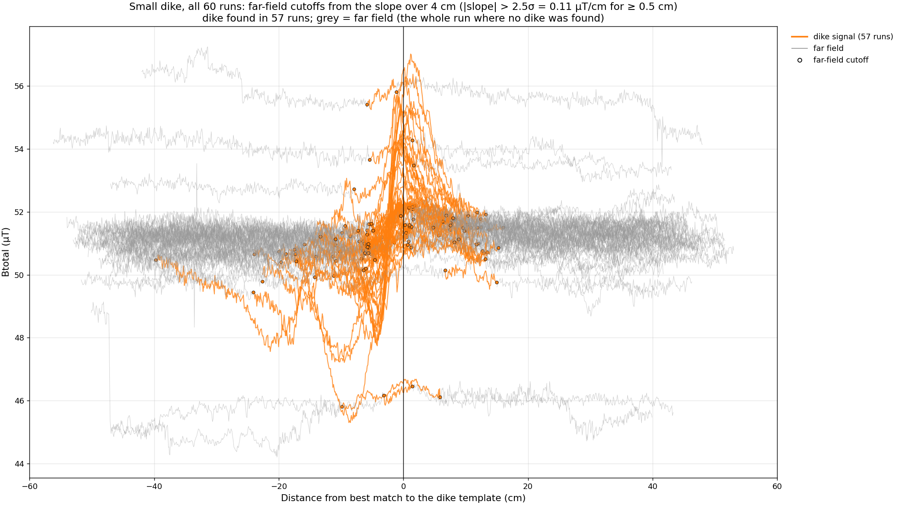
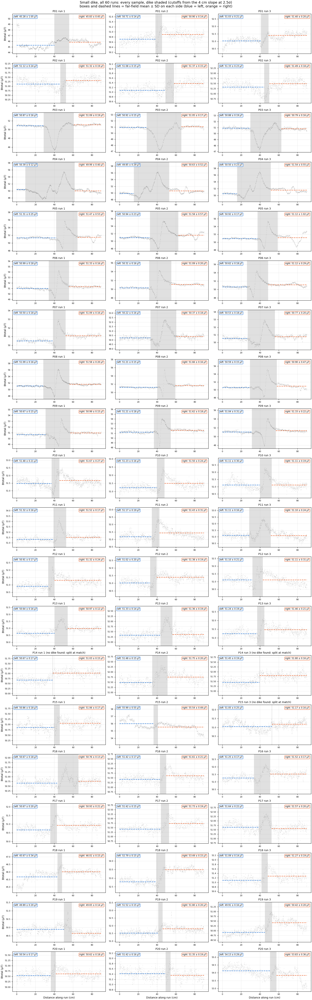
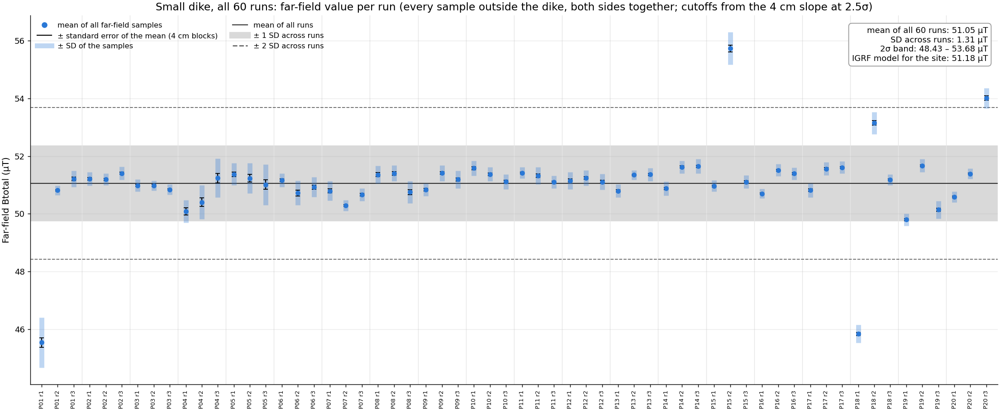

# Small Dike Far-Field Analysis

Oct 24, 2026 · Gabrielle Ursin

Across the 55 small-dike runs we keep, the far-field Btotal averages 51.07 µT (SD 0.41 µT across runs, median 51.16 µT), within 0.11 µT of the IGRF model value for the site (51.18 µT). Five runs with offset baselines are excluded.

## Method

The far field is every sample where Btotal is not changing faster than noise. We find the dike in each run from the slope of the field, cut it out with a margin, and average what is left. These parameters are fixed for all far-field work.

| Parameter | Value | What it does |
| --- | --- | --- |
| Quantity | Btotal | Not affected by phone rotation |
| Repeated rows | Dropped | Rows where the logger wrote the same Bx, By, Bz twice |
| Slope window | 4 cm, moving | Least-squares slope of Btotal vs distance, centred on each sample |
| Slope noise σ | 0.045 µT/cm | Robust spread of the slope ≥ 30 cm from the dike, in runs with no quality problems |
| Threshold | 2.5σ = 0.11 µT/cm | A sample counts as signal above this |
| Persistence | 0.5 cm | The slope must stay above the threshold this long |
| Dike search | ±10 cm of the dike match | The dike is the steep stretch nearest where the run best matches the dike shape |
| Gap bridging | 5 cm | Joins steep stretches split where the slope crosses zero at the dip and peak |
| Margin | 2 cm (half the window) | The far field starts this far beyond the dike signal |
| Uncertainty blocks | 4 cm | Far-field samples are averaged in 4 cm blocks for the standard error, since neighbouring samples are correlated |

Runs with no dike found count as far field throughout. With these settings the dike is found in 57 of 60 runs; we estimate 2–4 of the weakest detections (2.8–3.5σ) are noise, which only removes 5–10 cm from those runs' far fields.

## Far-field cutoffs

The dike signal typically spans 6.8 cm before to 6.9 cm after the dike match, so the far field starts there. The widest cutoffs are −39.7 cm (P04 r1, a long gentle slope before the dip) and +16.0 cm. No dike was found in P14 r1, P14 r3 and P15 r3; those runs are far field throughout.

Each run on its own, with the dike shaded and the far-field mean ± SD of each side in the boxes:

## Excluded runs

We drop five runs whose far-field value is outside 2σ of the run average. Four fail against all 60 runs (mean 51.05 µT, SD 1.31 µT); P18 r2 is hidden by them and fails once they are removed (mean 51.11 µT, SD 0.49 µT, 56 runs).

| Run | Far-field value (µT) | From mean, all 60 | From mean, top 4 removed |
| --- | --- | --- | --- |
| P01 r1 | 45.54 | −4.2σ | −11.3σ |
| P18 r1 | 45.84 | −4.0σ | −10.7σ |
| P20 r3 | 54.01 | +2.3σ | +5.9σ |
| P15 r2 | 55.73 | +3.6σ | +9.4σ |
| P18 r2 | 53.15 | +1.6σ | +4.1σ |

The same five fail the far-field level check against the IGRF model, and four were recorded between 11:27 and 11:41, so something nearby or the phone's handling likely shifted the baseline then. P01 r1 also has a 4 µT step at the start (friction noted in the field notes). We stop at one cut: repeating 2σ clipping keeps removing normal runs.

## Summary statistics

The 55 kept runs agree with the IGRF model to 0.11 µT, about twice the standard error of their mean.

| Statistic | 55 kept runs | All 60 runs |
| --- | --- | --- |
| Mean far-field value | 51.07 µT | 51.05 µT |
| SD across runs | 0.41 µT | 1.31 µT |
| Standard error of the mean | 0.055 µT | 0.17 µT |
| Median | 51.16 µT | 51.17 µT |
| 2σ band | 50.25–51.89 µT | 48.43–53.68 µT |
| IGRF model, Middlesex Fells, 2026-09-19 | 51.18 µT | 51.18 µT |

Three kept runs sit just outside the new 2σ band: P19 r1 (49.80 µT, −3.1σ), P04 r1 (50.09, −2.4σ) and P19 r3 (50.14, −2.3σ). About 3 of 55 are expected there by chance, so we keep them.

## Far-field value per run

Each run's far-field value is the mean of all its far-field samples, both sides together. Black bars are the standard error (4 cm blocks), pale bands the SD of the samples; the line, grey band and dashed lines are the mean, ±1 SD and ±2 SD across all 60 runs.

Repeat runs at one position often differ by more than their error bars (P14: 50.87 vs 51.62–51.65 µT), so baseline shifts between runs are larger than the noise within a run. The right side of the dike is higher than the left in 52 of 60 runs, by a median of 0.26 µT: a steady slope across the site, not the dike's tail.

## Per-run data

Cutoffs are in cm along each run (the distance_cm column): the far field is below the first and above the second. Runs with no dike are split at the dike match for the left/right means.

| Run | Dike found | Far field below (cm) | Far field above (cm) | Left mean (µT) | Right mean (µT) | Far-field mean (µT) | SD (µT) | SE (µT) | Kept |
| --- | --- | --- | --- | --- | --- | --- | --- | --- | --- |
| P01 r1 | yes | 40.2 | 56.0 | 45.28 | 45.83 | 45.54 | 0.87 | 0.170 | no |
| P01 r2 | yes | 38.3 | 45.3 | 50.71 | 50.90 | 50.81 | 0.17 | 0.029 | yes |
| P01 r3 | yes | 41.1 | 49.1 | 51.02 | 51.40 | 51.21 | 0.28 | 0.057 | yes |
| P02 r1 | yes | 46.5 | 52.5 | 51.12 | 51.32 | 51.21 | 0.24 | 0.042 | yes |
| P02 r2 | yes | 48.8 | 57.9 | 51.08 | 51.37 | 51.19 | 0.21 | 0.037 | yes |
| P02 r3 | yes | 44.6 | 50.0 | 51.33 | 51.49 | 51.41 | 0.22 | 0.044 | yes |
| P03 r1 | yes | 28.7 | 60.7 | 50.87 | 51.09 | 50.98 | 0.21 | 0.042 | yes |
| P03 r2 | yes | 29.1 | 65.9 | 50.91 | 51.05 | 50.98 | 0.17 | 0.037 | yes |
| P03 r3 | yes | 29.7 | 62.8 | 50.88 | 50.79 | 50.84 | 0.18 | 0.026 | yes |
| P04 r1 | yes | 9.2 | 61.6 | 50.39 | 49.99 | 50.09 | 0.40 | 0.124 | yes |
| P04 r2 | yes | 15.2 | 53.0 | 49.85 | 50.63 | 50.40 | 0.59 | 0.149 | yes |
| P04 r3 | yes | 15.8 | 51.6 | 50.51 | 51.54 | 51.24 | 0.67 | 0.167 | yes |
| P05 r1 | yes | 42.1 | 64.8 | 51.31 | 51.47 | 51.37 | 0.38 | 0.081 | yes |
| P05 r2 | yes | 32.5 | 62.5 | 50.94 | 51.58 | 51.23 | 0.53 | 0.132 | yes |
| P05 r3 | yes | 37.5 | 59.0 | 50.92 | 51.12 | 51.01 | 0.70 | 0.157 | yes |
| P06 r1 | yes | 34.1 | 55.8 | 50.99 | 51.33 | 51.16 | 0.24 | 0.049 | yes |
| P06 r2 | yes | 31.6 | 55.2 | 50.31 | 51.09 | 50.72 | 0.43 | 0.101 | yes |
| P06 r3 | yes | 26.2 | 48.8 | 50.62 | 51.12 | 50.92 | 0.35 | 0.075 | yes |
| P07 r1 | yes | 38.6 | 52.1 | 50.50 | 51.09 | 50.79 | 0.34 | 0.074 | yes |
| P07 r2 | yes | 33.0 | 60.5 | 50.22 | 50.37 | 50.29 | 0.18 | 0.032 | yes |
| P07 r3 | yes | 27.1 | 55.8 | 50.53 | 50.77 | 50.66 | 0.22 | 0.043 | yes |
| P08 r1 | yes | 28.4 | 56.1 | 51.09 | 51.58 | 51.36 | 0.31 | 0.072 | yes |
| P08 r2 | yes | 40.2 | 59.2 | 51.21 | 51.66 | 51.40 | 0.27 | 0.061 | yes |
| P08 r3 | yes | 29.4 | 58.0 | 50.59 | 50.90 | 50.75 | 0.39 | 0.087 | yes |
| P09 r1 | yes | 30.9 | 57.1 | 50.67 | 50.99 | 50.83 | 0.22 | 0.045 | yes |
| P09 r2 | yes | 36.6 | 54.5 | 51.21 | 51.62 | 51.41 | 0.27 | 0.053 | yes |
| P09 r3 | yes | 31.4 | 57.0 | 51.04 | 51.33 | 51.19 | 0.30 | 0.054 | yes |
| P10 r1 | yes | 37.2 | 45.4 | 51.48 | 51.67 | 51.58 | 0.26 | 0.051 | yes |
| P10 r2 | yes | 39.9 | 48.0 | 51.23 | 51.50 | 51.37 | 0.24 | 0.045 | yes |
| P10 r3 | yes | 40.0 | 52.5 | 51.11 | 51.11 | 51.11 | 0.25 | 0.047 | yes |
| P11 r1 | yes | 39.3 | 52.6 | 51.32 | 51.52 | 51.42 | 0.19 | 0.032 | yes |
| P11 r2 | yes | 34.4 | 42.5 | 51.17 | 51.43 | 51.32 | 0.29 | 0.058 | yes |
| P11 r3 | yes | 28.6 | 51.5 | 51.10 | 51.10 | 51.10 | 0.21 | 0.038 | yes |
| P12 r1 | yes | 33.5 | 40.2 | 50.91 | 51.32 | 51.15 | 0.30 | 0.056 | yes |
| P12 r2 | yes | 32.6 | 39.5 | 51.02 | 51.38 | 51.24 | 0.27 | 0.053 | yes |
| P12 r3 | yes | 32.0 | 43.0 | 51.10 | 51.11 | 51.11 | 0.27 | 0.054 | yes |
| P13 r1 | yes | 40.4 | 54.3 | 50.64 | 50.97 | 50.79 | 0.22 | 0.043 | yes |
| P13 r2 | yes | 43.6 | 56.3 | 51.33 | 51.36 | 51.35 | 0.17 | 0.025 | yes |
| P13 r3 | yes | 37.0 | 44.8 | 51.24 | 51.46 | 51.36 | 0.23 | 0.041 | yes |
| P14 r1 | no |  |  | 50.67 | 51.03 | 50.87 | 0.24 | 0.041 | yes |
| P14 r2 | yes | 34.9 | 51.2 | 51.48 | 51.74 | 51.62 | 0.22 | 0.040 | yes |
| P14 r3 | no |  |  | 51.45 | 51.80 | 51.65 | 0.25 | 0.042 | yes |
| P15 r1 | yes | 39.8 | 45.8 | 50.86 | 51.06 | 50.97 | 0.20 | 0.033 | yes |
| P15 r2 | yes | 36.2 | 40.8 | 55.99 | 55.54 | 55.73 | 0.56 | 0.121 | no |
| P15 r3 | no |  |  | 51.05 | 51.17 | 51.10 | 0.23 | 0.038 | yes |
| P16 r1 | yes | 43.8 | 65.9 | 50.67 | 50.76 | 50.70 | 0.17 | 0.027 | yes |
| P16 r2 | yes | 43.1 | 49.8 | 51.42 | 51.61 | 51.51 | 0.21 | 0.036 | yes |
| P16 r3 | yes | 33.7 | 50.8 | 51.25 | 51.52 | 51.39 | 0.21 | 0.039 | yes |
| P17 r1 | yes | 35.9 | 42.9 | 50.67 | 50.93 | 50.82 | 0.24 | 0.045 | yes |
| P17 r2 | yes | 43.9 | 52.7 | 51.42 | 51.73 | 51.56 | 0.23 | 0.041 | yes |
| P17 r3 | yes | 38.9 | 52.4 | 51.64 | 51.57 | 51.61 | 0.21 | 0.031 | yes |
| P18 r1 | yes | 43.5 | 48.2 | 45.67 | 46.01 | 45.84 | 0.31 | 0.061 | no |
| P18 r2 | yes | 39.1 | 48.7 | 52.79 | 53.49 | 53.15 | 0.38 | 0.081 | no |
| P18 r3 | yes | 41.6 | 48.2 | 51.09 | 51.27 | 51.18 | 0.19 | 0.033 | yes |
| P19 r1 | yes | 50.4 | 58.7 | 49.89 | 49.65 | 49.80 | 0.21 | 0.038 | yes |
| P19 r2 | yes | 41.2 | 45.8 | 51.52 | 51.80 | 51.67 | 0.23 | 0.035 | yes |
| P19 r3 | yes | 45.3 | 52.9 | 49.91 | 50.42 | 50.14 | 0.31 | 0.062 | yes |
| P20 r1 | yes | 36.4 | 41.7 | 50.54 | 50.62 | 50.59 | 0.18 | 0.025 | yes |
| P20 r2 | yes | 49.1 | 54.3 | 51.41 | 51.35 | 51.39 | 0.18 | 0.025 | yes |
| P20 r3 | yes | 50.8 | 57.6 | 54.13 | 53.83 | 54.01 | 0.35 | 0.077 | no |

To regenerate: `python analysis/small_dike_quality.py`, then `python analysis/small_dike_far_field.py`.
